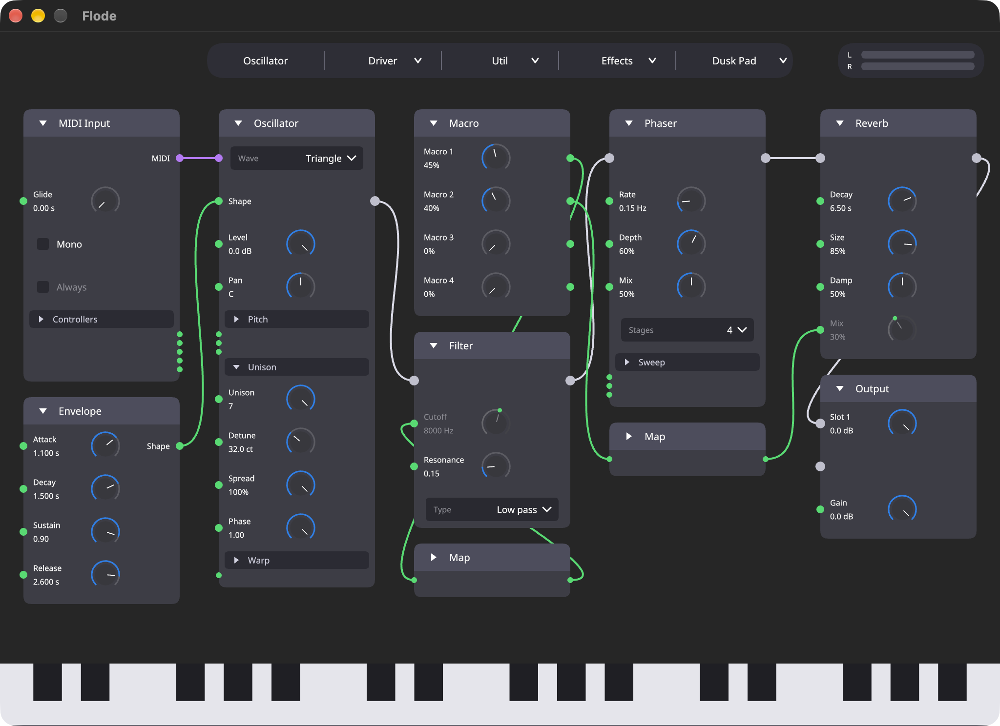
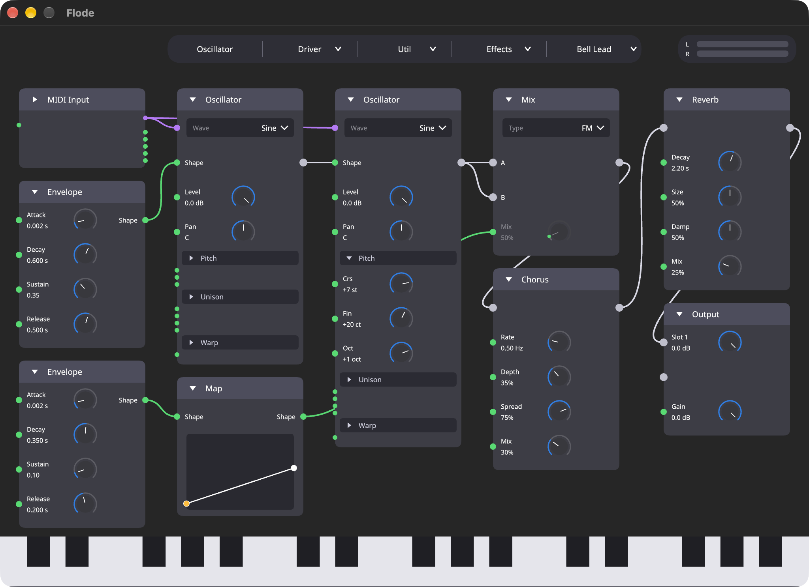
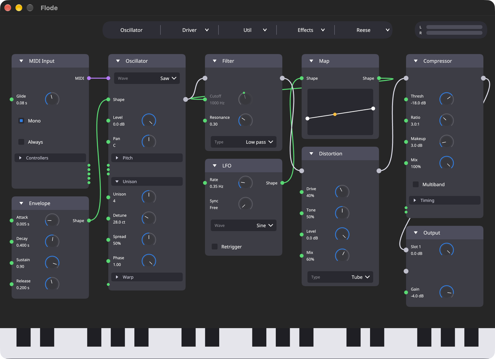
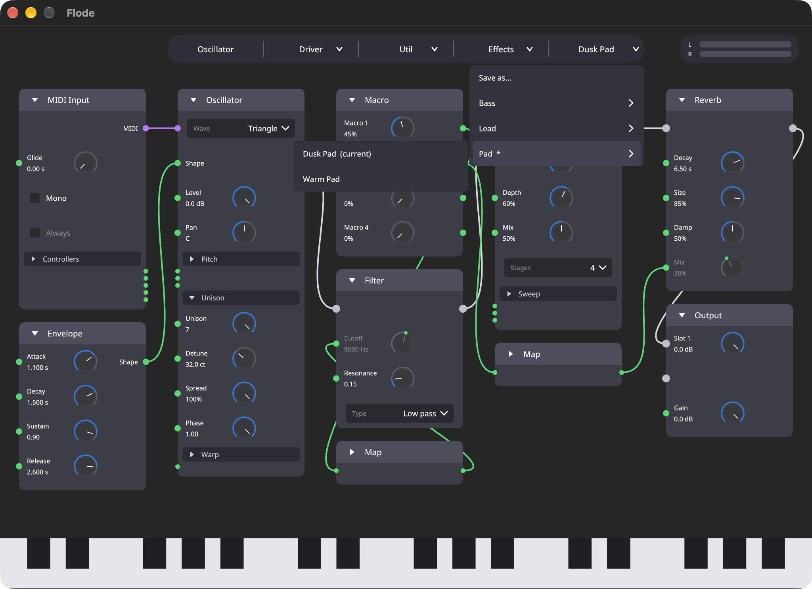
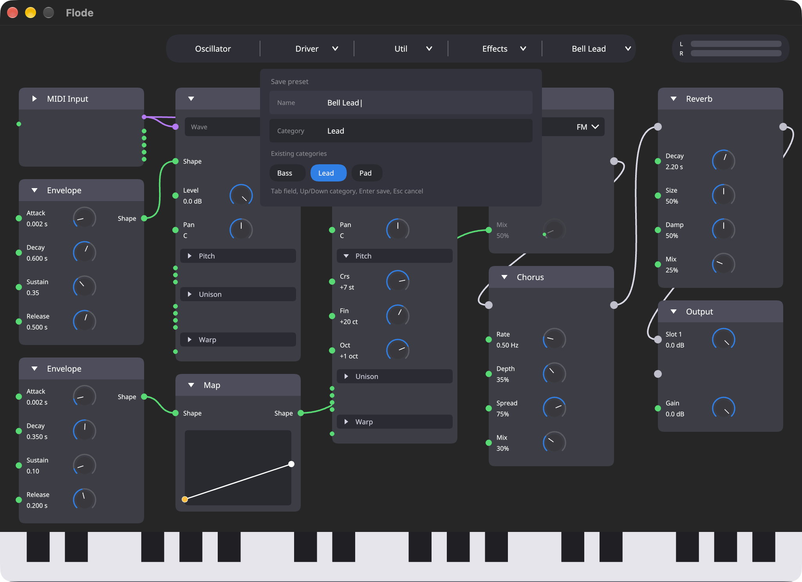

# Flode

A synth you build by wiring nodes together. Add oscillators, envelopes, filters, LFOs and effects
to a canvas, drag wires between them, and play it from your DAW or the built-in keyboard. It
builds as a VST3, a CLAP plugin, and a standalone app. It is written in Rust with
[nih-plug](https://github.com/robbert-vdh/nih-plug) and draws its own interface with iced.



## What is in it

**Nodes**

- **Oscillator.** Sine, saw, square, triangle and noise (white, pink, brown, Geiger). Up to seven
  unison voices with detune and stereo spread, pitch controls, and warp modes (bend, sync, PWM,
  asymmetry, flip, mirror, quantize). Each has its own level and pan.
- **Envelope, LFO and Map.** An envelope shapes an oscillator's amplitude or drives any knob. The
  LFO runs free or locks to the host's tempo. A map rescales a control signal through a curve you
  can drag.
- **Filter.** Low pass, high pass and band pass, run once per voice, so a filter envelope follows
  each note on its own.
- **Mix.** Crossfade, AM, ring modulation, or FM between two signals.
- **Effects.** Distortion (soft, hard, tube, fold, crush), compressor with a multiband mode,
  reverb, delay with tempo sync and ping pong, chorus, phaser, and flanger.
- **MIDI Input.** Sends notes to oscillators, and holds mono, glide, and the pitch wheel, mod wheel,
  velocity and aftertouch controllers.
- **Macro.** Four knobs that are host parameters, so your DAW can automate them. Each has a pin
  that can drive any knob in the graph.
- **Output.** Up to four slots, each its own chain with its own gain, and a master gain. A level
  meter sits in the corner.

**Wires.** Wires come in three colors. Grey is audio, green is control (envelopes, LFOs, macros and
controllers driving knobs), and purple is MIDI notes. A wire only joins ports of the same kind.
A knob with a green pin can be driven by any control wire, and it then shows the live value.

**Editing.**

- Click a node header to select it and drag it to move it. Drag a node onto a wire to splice it in.
- Fold the sections of a tall node, or collapse the whole node down to its pins.
- `M` mutes a source or bypasses a processor. `Shift+D` duplicates the selected node. Both are also
  in the right-click menu.
- Scroll to pan and pinch to zoom.
- The computer keyboard plays notes in the standalone app, and the strip at the bottom is
  clickable in the plugin.

**Presets.** The Presets button saves and loads whole patches, sorted into categories. See
[Presets](#presets) below.



## Install

Flode has been built and tested on macOS, and used in Ableton Live 12. Other systems may work but
are untested.

You need a recent stable Rust toolchain and a network connection for the first build, since
nih-plug is fetched from git.

```sh
cargo xtask bundle flode --release
```

The bundles are written to `target/bundled/`. Copy them where your host looks for them:

```sh
cp -R target/bundled/flode.vst3 ~/Library/Audio/Plug-Ins/VST3/
cp -R target/bundled/flode.clap ~/Library/Audio/Plug-Ins/CLAP/
```

Restart or rescan in your DAW. The standalone app comes from a debug bundle
(`cargo xtask bundle flode`), and `./build.sh` rebuilds and relaunches it whenever a source file
changes.

## Using it

1. Add nodes from the pill at the top, or start from a preset. A new graph has a MIDI Input, an
   Oscillator, an Envelope and an Output already wired.
2. An oscillator plays only the notes wired into its MIDI pin, so it is silent until a MIDI Input
   is connected.
3. Wire audio into an output slot to hear it.
4. The output of an effect can go to another effect or to an output slot, and nowhere else. Effects
   run on the summed voices, so a filter or an oscillator cannot take an effect as its input. You
   can have four of each kind of effect.
5. A graph has one Output node and one Macro node. They cannot be added a second time or duplicated.

Mono, glide and "glide on every note" are on the MIDI Input node. In mono mode a new note cuts the
tail of the last one short.



## Presets

Presets are files in `~/Library/Application Support/Flode/Presets`, one per name. Each holds the
graph and the four macro values. A category is a folder inside that one, so `Bass/Reese.flode` is
the Reese preset in the Bass category.

The Presets button opens a list with "Save as...", then the categories, then any presets with none.
A category opens a submenu of its presets when you hover it or click it. "Save as..." opens a box
with a name and a category. The existing categories show as chips you can click, or step through
with the up and down keys, so a typo does not make a new folder. A category that does not exist
yet is tagged "new". Saving under a name that already exists replaces that preset.




Six factory presets are built in code in `src/editor/factory/`: Sub Bass and Reese, Pulse Lead and
Bell Lead, Warm Pad and Dusk Pad. To write them into your preset folder:

```sh
cargo test --lib write_factory_presets -- --ignored
```

## Development

```sh
cargo test
```

The tests cover the graph model, the compiler that turns a graph into a patch, the engine, every
effect, and the editor's input handling. The audio thread must never allocate, and `nih-plug` is
built with `assert_process_allocs`, so a debug build panics on an allocation there. A test plays a
patch that runs all seven effects with allocation forbidden.

Two environment variables help when taking screenshots. `FLODE_PRESET` (`Category/Name`) starts the
editor with a preset loaded, `FLODE_UI` (`presets`, `presets:Bass`, `save`) opens part of the
interface, and `FLODE_PRESET_DIR` points the editor at another preset folder. They are read once,
at start. See `src/editor/demo.rs`.

### Layout

```
src/
  lib.rs          the plugin: host events and buffers in, calls on the engine out
  dsp/            filters, oscillators, wavetables, envelopes, and the effects
  engine/         voices, lanes, the stage arena, LFOs, and the effect pool
  patch/          what the editor hands the audio thread: stages, control routes, the compiler
  nodes/          the node kinds: their rows, knobs, ports, and layout
  editor/         the canvas, drawing, menus, shortcuts, saving, and the factory presets
  presets.rs      preset files and the folder they live in
xtask/            bundles the plugin formats
vendor/           patched copies of baseview and iced_baseview
docs/             design notes
```

A graph compiles to a small arena of stages for each output slot, in signal order. Each voice runs
the arena, and the effects run on the summed voices after it. `docs/effects-plan.md` has the
details for the effects.

`vendor/` holds two crates the build patches: `baseview`, for a nil-window check on newer macOS,
and `iced_baseview`, for a method that needs a newer baseview API. They keep their own licenses.

## Status

Flode is young. The DSP is covered by tests for level, stability, filter and delay behavior, and
allocation on the audio thread, but how it sounds is still being tuned by ear. Known limits:

- Nothing can be wired after an effect except another effect or an output slot.
- There are four instances of each effect kind. A fifth passes its input through.
- The distortion adds about 15 samples of latency when its mix is above zero.
- The FM mix delays the signal by a few cycles of the note, so that knob moves do not bend the
  pitch.
- The preset list has no scrolling, delete, or rename. Delete the files to remove a preset.
