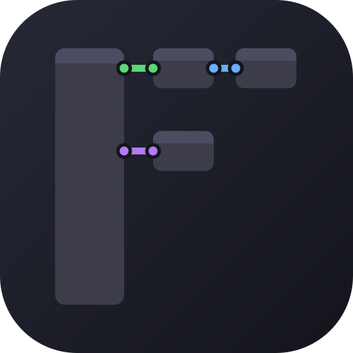
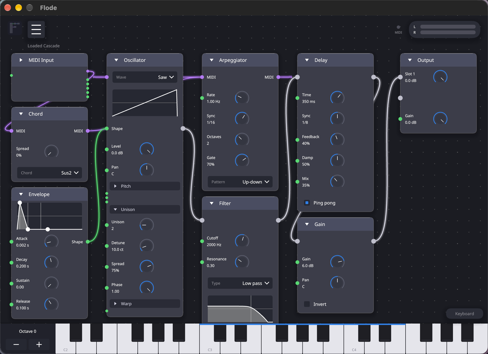
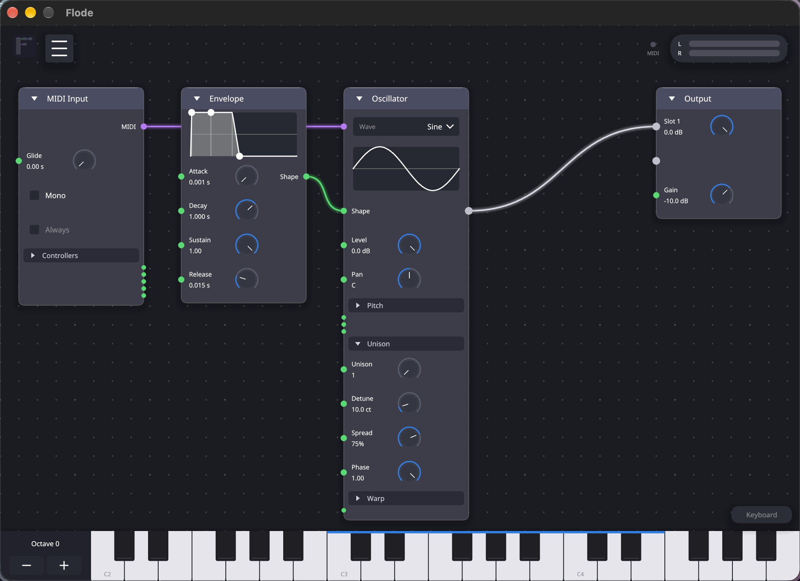

<p align="center"></p>

# Flode

A synth you build by wiring nodes together. Add oscillators, envelopes, filters, LFOs and effects
to a canvas, drag wires between them, and play it from your DAW or the built-in keyboard. It
builds as a VST3, a CLAP plugin, and a standalone app. It is written in Rust with
[nih-plug](https://github.com/robbert-vdh/nih-plug) and draws its own interface with iced.

Flode's way of working borrows from the node editors in [Blender](https://www.blender.org): you
describe a sound by wiring small pieces together instead of filling in one big panel, and you can
see how everything connects. See [docs/nodes.md](docs/nodes.md#where-the-idea-comes-from) for more
on that, and the full node reference.



## Install

Flode has been built and tested on macOS, and used in Ableton Live 12. Other systems may work but
are untested.

You need a recent stable Rust toolchain and a network connection for the first build, since
nih-plug is fetched from git.

```sh
./build.sh --release
```

The bundles are written to `target/bundled/`. The bundler has no icon option, so `build.sh` runs
`assets/apply-icon.sh` after it to add `assets/icon.icns` to each bundle. To regenerate the icon
from `assets/icon.svg`, run `sh assets/make-icns.sh`. Then copy the bundles where your host looks
for them:

```sh
cp -R target/bundled/flode.vst3 ~/Library/Audio/Plug-Ins/VST3/
cp -R target/bundled/flode.clap ~/Library/Audio/Plug-Ins/CLAP/
```

Restart or rescan in your DAW. The standalone app comes from a debug bundle
(`./build.sh`), and `./build_and_watch.sh` rebuilds and relaunches it whenever a source file
changes.

## Quick start

1. Add nodes from the burger menu at the top left, beside the logo, or start from a preset. A new
   graph has a MIDI Input, an Oscillator, an Envelope and an Output already wired.
2. An oscillator or a sampler plays only the notes wired into its MIDI pin, so it is silent until a
   MIDI Input is connected.
3. Wire audio into an output slot to hear it.
4. A graph has one Output node and one Macro node. They cannot be added a second time or duplicated.

Click the key strip at the bottom of the editor to play notes, in the plugin and in the standalone
app, or press play from your DAW. The docs below cover everything else: the full node list, wiring
and editing gestures, keyboard shortcuts, groups, and presets.



## Docs

- [Node reference](docs/nodes.md): every node, wiring and editing gestures, keyboard shortcuts,
  editor modes
- [Groups](docs/groups.md): grouping nodes, and saving a group to its own file
- [Presets](docs/presets.md): saving, loading, and categories
- [Development](docs/development.md): running tests, the source layout, and the effects pipeline
- [Status](docs/status.md): known limits

## Contributing

See [CONTRIBUTING.md](CONTRIBUTING.md).

## License

GPL-3.0-or-later. See [LICENSE](LICENSE).
